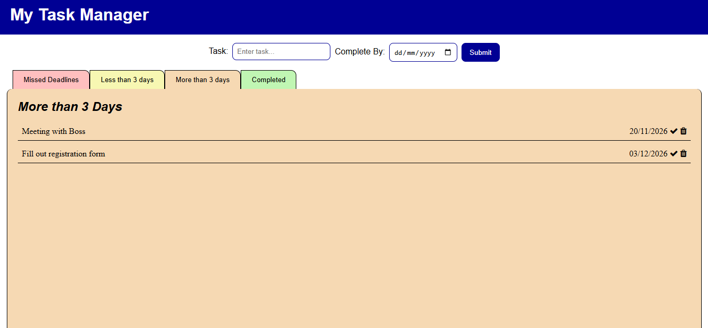

# Task Manager Vite

## Preview



> Screenshot before to be deleted section


<br>
<a href="https://task-manager-flax-nu.vercel.app" target="_blank">Live Link Here</a>

## Overview

A self made project with no given instructions. A test of my ability and something I would be able to use going forward. 
I wanted to create a task manager that help me see when a deadline is approaching, and plan to keep updating, learning and updating my skills.
The layout is designed to look similar to folder with the buttons on top resembling dividers. 
<br>
<strong>Blog post with further detail into my thought process <a href="https://medium.com/@mgstafford/task-manager-react-self-learning-922cac41eae8" target="_blank">Medium Blog Post</a></strong>

## Features

- Input date and task into a task manager, updates into four categories. Missed deadlines, Less than 3 days, More than 3 days, and Completed.
- Able to check completed tasks, moves to separate viewing field for user.
- Select which category you want to view and displays in a folder like setup.
- Ability to delete and undo completed tasks, to anticipate human error and improve usability.
- <strong>New</strong>  - Deleted items moved to separate section allowing user to undo action if there is human error.

  
## Technologies

 - JSX - React Vite for page structure, and functionality.
 - CSS3 for styling.

## Installation

Follow these steps to run the project locally on your machine:

### Prerequisites
* **Node.js** (v18.0.0 or higher recommended)
* **npm** (v9.0.0+)

### Step-by-Step Instructions

1. **Clone the repository:**
   ```bash
   git clone https://github.com
   cd my-react-app
   ```

2. **Install project dependencies:**
   Choose the command matching your package manager:
   ```bash
   npm install
   ```

3. **Start the local development server:**
   ```bash
   npm run dev 
   ```

4. **Open the application:**
   Once the server boots up, Vite will provide a local URL (usually `http://localhost:5173`). Ctrl+Click or paste that address into your browser to view the app.

## Deployment

The website is hosted on Vercel.

Visit the live version here:

https://task-manager-flax-nu.vercel.app

## Credits

By Matthew Stafford (Me)

A Front-End Developer project to advertise myself and my skills
